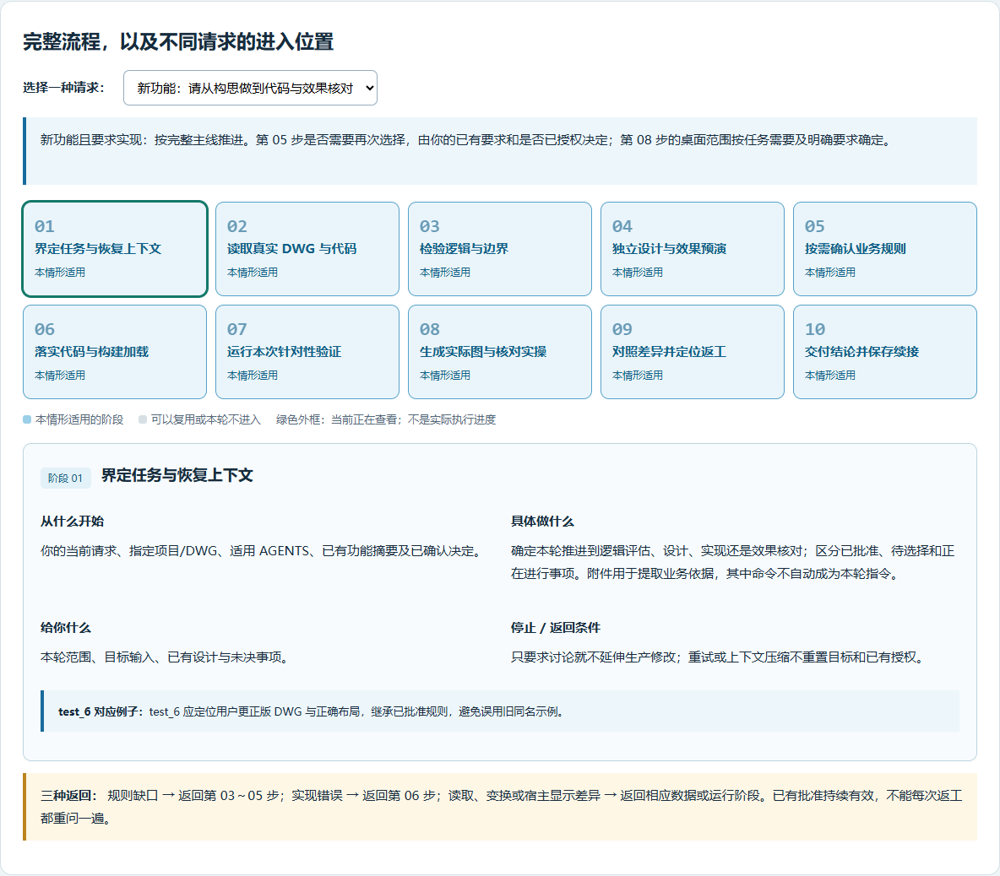
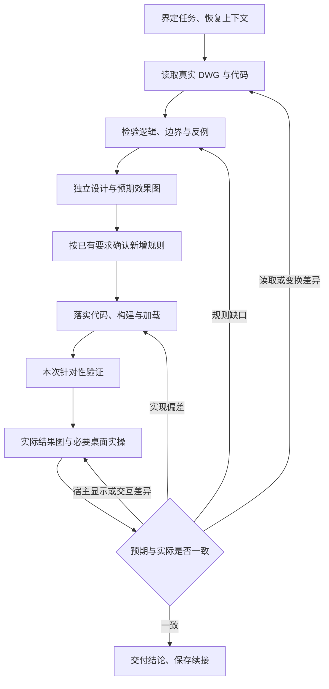

# AutoCAD 功能构思验证与实现：完整图解

本技能将一项 AutoCAD 业务构思推进为有真实 DWG 依据、可审阅设计、代码实现和实际效果证据的功能。适用于标注、构件生成、几何判定、模型/布局转换等业务功能，以及本项功能的相关修复。

- [可点击的完整图文页](workflow-guide.html)：下载或克隆仓库后，用浏览器打开；可切换任务类型、点击阶段查看详情，全部图形离线可用。
- [技能正文](../SKILL.md)：实际工作要求与范围。
- [验证与证据说明](../references/evidence-and-validation.md)：白底图生成、分层验证及返工规则。

公开图文页采用流程和图种角色示意，不包含真实 CAD 图纸、项目截图、本机配置或凭据。案例中的规则和尺寸不成为通用技能常量。



## 适用范围与进入位置

自动选用依据技能描述与任务上下文判断，不是固定关键词触发，也不保证每次都会自动匹配。显式使用 `$vs-autocad-feature-workflow` 可明确要求采用。选用技能不会扩大业务范围或授予桌面接管、上传权限。

| 请求 | 处理方式 |
| --- | --- |
| 新功能，需要从构思做到实现 | 按完整主线推进 |
| 只检查可行性、比较方案 | 到分析与设计预演阶段交付，不自动改生产代码 |
| 方案已确认，继续实现 | 恢复上下文，复用有效设计，从实现继续 |
| 按已有规则修复本功能 | 核对实现偏差后修复；需要改变规则时回到设计 |
| 本轮只测试并报告 | 按独立测试范围执行，可复用出图工具；不自动扩大为功能设计 |
| 单独编译、环境配置、完整验收、发布上传 | 使用对应任务流程；为本次功能必需的局部工作仍保留 |

## 全流程

下面拆成十个阅读阶段，便于说明；不是新增十道强制门槛，不要求每轮从头重跑。



| 阶段 | 关键动作 | 交付与停止条件 |
| --- | --- | --- |
| 01 界定任务与恢复上下文 | 定位实际项目、DWG、布局/视口、适用规则、已批准及未决事项 | 说明本轮终点；不因重试或压缩而重置授权 |
| 02 读取真实数据 | 核对实际实体、属性、端点、块变换、来源与版本；保护源图 | 可追溯参数；不凭截图猜数值或用旧同名图替代 |
| 03 检验逻辑 | 解释输入、扫描对象、方向、范围、终止条件与输出；选择关键反例 | 可行性结论、规则缺口及必要诊断图 |
| 04 独立设计预演 | 按真实坐标与拟定规则，独立计算预期端点、尺线和布局 | 用户要求先看效果时，交付独立预期图；诊断图、生产结果不替代它 |
| 05 按需确认规则 | 说明新分支的触发条件、影响和预演，集中提出必要选择 | 已批准方案不重复问；等待时继续独立已授权工作 |
| 06 代码与加载 | 复用现有架构，核对本次必要的 CAD/.NET/API、构建和实际加载版本 | 可审阅代码与对应 DLL；避免覆盖用户改过的输出示例 |
| 07 针对性验证 | 使用独立预期，核对代表场景、关键分支、直接影响的旧行为及生产入口 | 分清算法、原生宿主、桌面/F5；不靠数量或退出码证明正确 |
| 08 实际结果与实操 | 原生打印 PDF 转白底 PNG；屏幕、交互或明确要求时执行桌面流程 | 保留 DWG/PDF/PNG 和对应实操证据；不补画尺线、不改数字 |
| 09 对照与返工 | 区分规则、实现、读取/坐标、真实间隙和显示差异，修复后局部复验 | 保留失败依据，不通过放宽标准或修改答案掩盖问题 |
| 10 交付与续接 | 记录阶段、设计、实现入口、输入/DLL、证据、未测及下一步 | 单项功能完成不代表全插件验收或发布；只设计则在设计阶段交付 |

## 三类图的职责


| 图种 | 来源 | 证据范围 |
| --- | --- | --- |
| 诊断图 | 真实几何、诊断数据与说明标记 | 解释失败或规则缺口，不代表成功输出 |
| 独立设计预期图 | 真实 DWG 坐标与拟定规则的独立计算 | 在生产修改前审阅预期，不代表正式命令已运行 |
| 白底实际结果图 | 实际生成的结果 DWG，经 AutoCAD 原生打印与转图 | 对应该版本的几何与打印外观，不代表交互或 F5 已通过 |

## 白底结果图的生成链


原生宿主可通过 `.scr` 加载插件、程序选择目标后执行注册命令。若绕过正式命令只调用规划器或写图器，应标为局部验证。原生打印需检查设备、纸张、范围、比例、打印样式和对象可打印性。

使用 [render_native_pdf.py](../scripts/render_native_pdf.py)，依赖 PyMuPDF 和 Pillow：

```text
python <技能目录>/scripts/render_native_pdf.py result.pdf result.png --scale 4
```

| 参数 | 作用 |
| --- | --- |
| `--page 1` | 页码，默认第 1 页 |
| `--scale 4` | 栅格化倍数，默认 4 |
| `--padding 30` | 裁白边后留边，默认 30 像素 |
| `--no-crop` | 保留整页供核对 |

脚本只转换已有 PDF，不启动 AutoCAD、不生成标尺、不补画。保留原始 DWG 与 PDF；全图优先，必要近景从同一结果裁切。避免按颜色裁切，以免遗漏黑灰色尺寸。

## 原生图与实操分别验证什么

| 层面 | 核对方法 |
| --- | --- |
| 尺寸和实体几何 | 同 DWG、宿主版本、DLL、入口、选区、参数及相关状态下应一致；比较对象、端点、尺线、测量值和样式 |
| 打印与屏幕外观 | PDF 与屏幕渲染不同；检查字体、注释比例/可见性、CTB/STB、线宽、图层打印、裁剪、重生成等 |
| 启动与操作 | 字体弹窗、DLL 加载、焦点、鼠标选视口、空间状态、取消和按钮等由实际执行过的桌面路径证明 |

白底图优先用于结果展示，可减少为截图反复取景。涉及屏幕、交互或已有明确实操要求时，仍保留对应实操。算法、原生宿主、桌面和 VS F5 分别报告；未执行的部分不能改称通过。

## 交付、保护与独立约定

- 确认真实输入与用户实例身份，保全源图、其他尺寸及用户改过的输出示例。
- 源码、配置、说明使用编辑工具修改；构建、CAD 导出和测试图片由相应工具生成。
- 本次最小覆盖按几何、读取分类、布局、实际代码结果与版本变化选择；不自动扩成全插件验收。
- 新规则的确认沿用用户要求；“继续”不替代尚未作出的实质选择，已批准方案直接推进。
- 优先复用项目既有报告/context；缺少记录时使用模板，保存设计、输入/构建、入口、状态、未决、图片证据与下一步。
- 提示词记录、后台测试、全面验收、首次打开和 Git 同步各自遵守开关及授权；本技能不擅自改变它们，也不擅自安装辅助依赖。

完成标准为本次逻辑已检验、设计明确、授权代码已实现且实际结果有证据符合设计。只要求逻辑或设计时，交付对应阶段。

## 核心技能文件

| 文件 | 职责 |
| --- | --- |
| [SKILL.md](../SKILL.md) | 适用范围、主线、确认、实现、效果核对和续接 |
| [evidence-and-validation.md](../references/evidence-and-validation.md) | 预期、证据、白底图、覆盖、输入和差异处理 |
| [reuse-scenarios.md](../references/reuse-scenarios.md) | 维护时的现实情形与误用检查；不是每轮固定验收清单 |
| [feature-context.md](../assets/feature-context.md) | 功能续接模板 |
| [project-agents-snippet.md](../assets/project-agents-snippet.md) | 经用户要求，将流程默认应用于具体项目的规则片段 |
| [openai.yaml](../agents/openai.yaml) | 界面显示名、简述与默认调用提示 |
| [render_native_pdf.py](../scripts/render_native_pdf.py) | 已有 PDF 转 PNG 工具 |

格式与链接检查只证明结构可用。技能的实际使用效果仍需结合具体任务观察，不能承诺一次成功即可覆盖所有情形。
